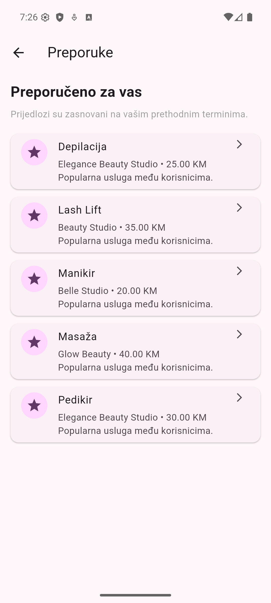

# eTermin - dokumentacija recommender sistema

## 1. Opis

eTermin koristi Content-Based Filtering nad kategorijama usluga i salonima koje je korisnik ranije posjećivao. Preporuke su aktivne usluge koje korisnik još nije rezervisao, rangirane prema podudaranju sa njegovim profilom.

## 2. API endpoint

Preporuke su dostupne putem endpointa:

`GET /api/Recommendations/my`

Endpoint zahtijeva autentifikaciju. Korisnik se identifikuje na osnovu `NameIdentifier` claim-a iz JWT tokena.

## 3. Algoritam

Profil se formira iz svih termina korisnika osim otkazanih. Za svaki termin uzimaju se kategorija rezervisane usluge i salon.

Za svaku aktivnu uslugu koju korisnik nije rezervisao računa se rezultat:

- `2 × broj korisnikovih termina u istoj kategoriji`
- `+ broj korisnikovih termina u istom salonu`

Kategorija ima veću težinu, a ranije posjećeni salon je dodatni signal. Usluge bez podudaranja kategorije ili salona se ne prikazuju. Prvih pet rezultata bira se po rezultatu, zatim po ukupnoj popularnosti usluge među neotkazanim terminima, pa po nazivu radi stabilnog redoslijeda.

Razlog preporuke navodi podudarnu kategoriju kada postoji; u suprotnom navodi salon koji je korisnik ranije posjećivao.

### Korisnik nema historiju

Kada korisnik nema termina koji nisu otkazani, popularnost je jedini signal. Broj neotkazanih termina grupiše se po usluzi, a aktivne usluge se sortiraju po tom broju. Vraća se najviše pet usluga; izjednačenja se razrješavaju po nazivu. Razlog je „Popularna usluga među korisnicima.“

Popularnost se koristi samo za korisnika bez historije, a ne kao zamjena kada nema podudaranja s postojećim profilom.

## 4. Podaci preporuke

Svaka preporuka vraća sljedeće podatke:

- `ServiceId`, `ServiceName`, `Description`
- `ServiceCategoryId`, `ServiceCategoryName`
- `DurationInMinutes`, `Price`
- `SalonId`, `SalonName`
- `Reason` - razumljivo objašnjenje podudaranja kategorije/salona ili popularnosti

## 5. Mobilna aplikacija

Početna sekcija „Preporučene usluge“ i ekran „Preporuke“ pozivaju recommender endpoint. Oba prikazuju razlog uz svaki prijedlog. Otvaranje preporuke vodi u rezervaciju, a po povratku iz toka rezervacije preporuke se ponovo učitavaju.

## 6. Arhitektura i ograničenja

- `IRecommendationService` definise servis preporuka.
- `RecommendationService` učitava historiju, rangira usluge i gradi razlog.
- `RecommendationDto` nosi podatke koji se vraćaju klijentu.
- `RecommendationsController` izlaže endpoint.

Servis je registrovan kao scoped u ASP.NET Core dependency injection sistemu. Algoritam je deterministički i ne koristi trenirani model. Model trenutno nema zasebna polja za tip salona ili vrstu tretmana, pa se oni ne koriste kao signali.
